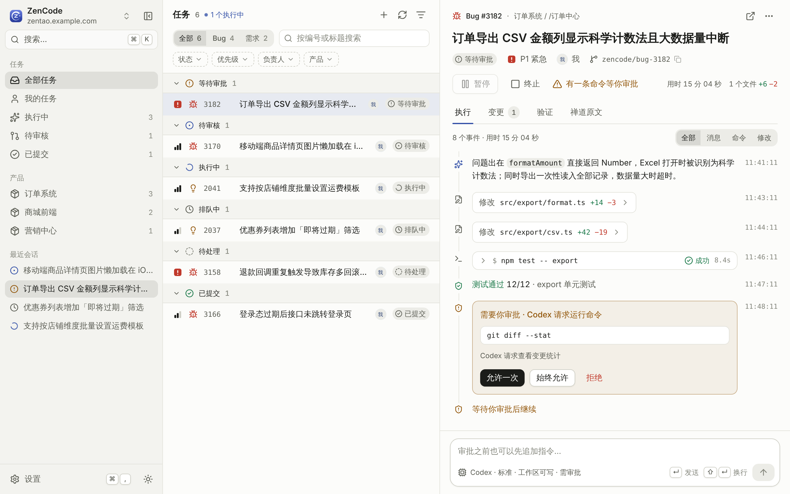
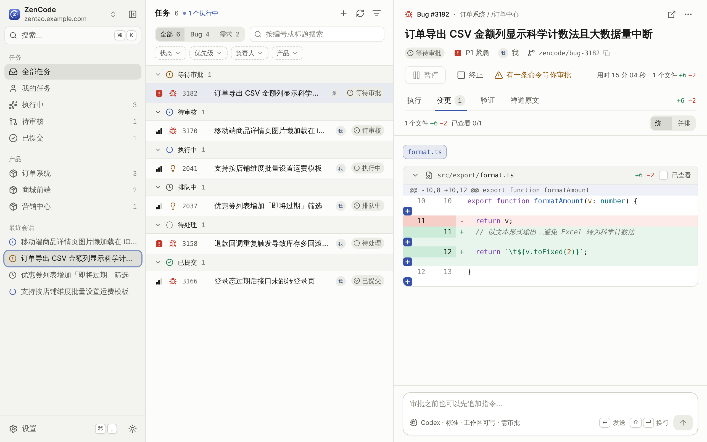
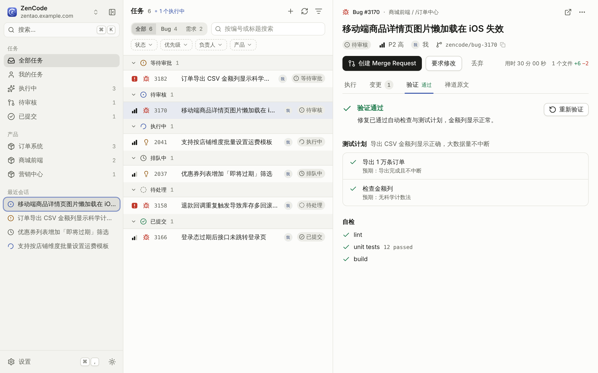

<div align="center">


# ZenCode

**From ZenTao bug to GitLab merge request — with Codex doing the coding, and you doing the review.**

English · [简体中文](README.zh-CN.md)

[Download](https://github.com/yoonzm/zencode/releases) · [Technical notes](docs/technical-notes.md) · [Report an issue](https://github.com/yoonzm/zencode/issues)


</div>

ZenCode is a desktop app that turns your assigned [ZenTao](https://www.zentao.net/) bugs and stories into reviewed GitLab merge requests. It syncs tasks, hands them to the [Codex CLI](https://github.com/openai/codex) in an isolated checkout, and shows you every step — you approve commands, read the diff, and only then submit the MR.

<p align="center">
  
</p>

> Screenshots use demo data.

## Features

- **Automatic sync** — pulls bugs and stories assigned to you (or a whole product) from ZenTao on a schedule; new tasks can start automatically.
- **Isolated execution** — each task is cloned into its own directory and branch, so your local working copies are never touched.
- **Live timeline** — follow Codex's plan, file reads, commands, edits and test results; pause, resume, or send extra instructions at any time.
- **Human in the loop** — command and file approvals are yours to allow once, always, or deny. Nothing is pushed until you click **Create Merge Request**.
- **Real diff review** — unified or side-by-side Git diff, per-file "viewed" tracking, and request changes before submitting.
- **Automated verification** — Codex drafts a test plan and runs it (UI, API or CLI checks), with evidence attached to the task.
- **Multi-repo mapping** — one product can map to several GitLab projects (frontend, backend, services), each with its own branch, test command, review and MR.
- **AI matching** — suggests ZenTao product ↔ GitLab repository mappings from real task and commit evidence.
- **Manual requirements** — paste any text, let Codex organize it into tasks, then import.
- **Safe by design** — credentials live in the OS keychain, ZenTao is read-only, and updates are signature-verified.

<table>
  <tr>
    <td width="50%"></td>
    <td width="50%"></td>
  </tr>
  <tr>
    <td align="center"><b>Review the diff</b></td>
    <td align="center"><b>Verify the fix</b></td>
  </tr>
</table>

## How it works

```
ZenTao  ──sync──▶  ZenCode  ──isolated clone──▶  Codex CLI
                      │                              │
                      │◀──── events · approvals ─────┘
                      ▼
               You review the diff  ──▶  GitLab Merge Request
```

## Getting started

**Install** — download the Windows `.exe` or macOS `.dmg` (Apple Silicon / Intel) from [Releases](https://github.com/yoonzm/zencode/releases). macOS 13.3+ is required.

**Set up**

1. Install the [Codex CLI](https://github.com/openai/codex) and run `codex login`.
2. Open ZenCode and connect ZenTao (REST v1, token or password) and GitLab (personal access token).
3. Map each ZenTao product to one or more GitLab projects and target branches.
4. Sync — tasks appear in the list and Codex gets to work.

Git push uses your own SSH keys / credential helper.

## Build from source

Requires Node.js 24, stable Rust, Git and the [Tauri prerequisites](https://v2.tauri.app/start/prerequisites/).

```bash
npm ci
npm start          # run the desktop app in dev mode
npm test           # Rust core + frontend tests
npm run package    # build installers
```

## Status

ZenCode is under active development. Live ZenTao/GitLab flows and native Windows/macOS interactions still need validation on real tenants; Linux credential storage is not supported yet. See the [technical notes](docs/technical-notes.md) for runtime details, release process and verified coverage.

## Acknowledgements

UI based on [yoonzm/zencode-ui](https://github.com/yoonzm/zencode-ui), built with [Tauri](https://tauri.app/), [React](https://react.dev/), [Tailwind CSS](https://tailwindcss.com/), [Radix UI](https://www.radix-ui.com/) and [HeroUI](https://www.heroui.com/).
